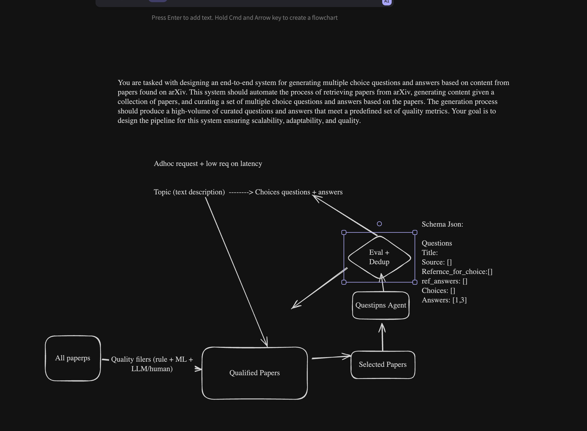
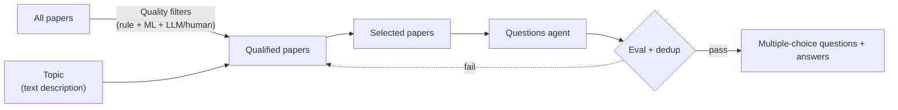

# ML design: multiple-choice questions from arXiv papers

[← Snorkel index](README.md)

Saved 2026-10-19 from the interview whiteboard.

## The prompt

> You are tasked with designing an end-to-end system for generating multiple choice questions and answers based on content from papers found on arXiv. This system should automate the process of retrieving papers from arXiv, generating content given a collection of papers, and curating a set of multiple choice questions and answers based on the papers. The generation process should produce a high-volume of curated questions and answers that meet a predefined set of quality metrics. Your goal is to design the pipeline for this system ensuring scalability, adaptability, and quality.

## My whiteboard



### Transcribed

**Assumption noted:** ad hoc requests, with a low requirement on latency.

**Interface:** a topic (text description) goes in; multiple-choice questions and answers come out.

**Pipeline:**



1. **All papers → Qualified papers:** quality filters combining rules, ML models, and LLM or human review.
2. **Topic → Qualified papers:** the topic description selects from the qualified pool.
3. **Selected papers → Questions agent:** generates the questions.
4. **Eval + dedup:** passing items become the output; the arrow drawn back toward the paper pool is the retry path for items that fail (read as such; confirm).

**Output schema (JSON):**

```json
{
  "questions": [
    {
      "title": "",
      "source": [],
      "reference_for_choice": [],
      "ref_answers": [],
      "choices": [],
      "answers": [1, 3]
    }
  ]
}
```

`answers` holds the indices of the correct choices, so a question can have more than one correct answer.
