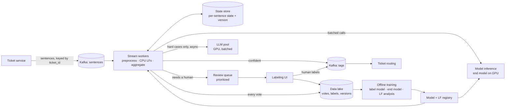

# Model answer: state-machine tagging workflow for streaming sentences

[← Snorkel index](README.md)

**The prompt:** Design a state-machine-style tagging workflow for incoming sentences, based on Snorkel's labeling workflow approach. Customer support tickets stream in one sentence at a time; tag them as billing / technical issue / account access, using labeling functions (small heuristic rules), a way to combine their votes, and humans as the fallback.

**What the round tests** (per the recruiter): scalable distributed systems, performance, and hardware trade-offs. So the state machine is the entry point, not the whole answer — budget real time for scale and hardware.

## The 60 minutes

| Minutes | Phase | What you produce |
| --- | --- | --- |
| 0–5 | Clarify | 4–5 questions, then state your assumptions out loud |
| 5–10 | Requirements and numbers | Functional / non-functional list; back-of-envelope math |
| 10–20 | The state machine | States, transitions, and an arrow for every edge case |
| 20–30 | Architecture | Online path, offline path, the feedback loop |
| 30–50 | Deep dives | Label aggregation, LLM cascade, scaling, hardware, failure handling |
| 50–60 | Evaluation and wrap-up | How you'd know it works; what you'd build first |

Say the plan at the start: *"I'll clarify, size it, draw the state machine, then the architecture, and spend most of the time on scaling and the hardware trade-offs."* Interviewers relax when you manage the clock.

## 1. Clarify (0–5 min)

Ask these, then state an assumption for each so you never stall waiting for an answer:

| Question | Why it matters | Assume if they don't answer |
| --- | --- | --- |
| **"Are these tags the final output, or weak labels to train a downstream classifier?"** | The highest-signal question — it shows you know what Snorkel does | **Both.** Online: provisional tags to route tickets now. Offline: the same votes become training labels for an end model that generalizes beyond the rules |
| "Does a tag apply per sentence or per ticket? Can a ticket have several?" | Decides whether you need per-ticket state | One class per sentence (billing / technical / account access / other); a ticket is multi-label, aggregated from its sentences |
| "How fast must a tag appear?" | Splits the sync path from the async path | Auto-tags p99 < 500 ms for routing; human review is async, minutes to hours |
| "What volume, and how spiky?" | Drives every scaling decision | 50M sentences/day, ~600/s average, ~3K/s peak |
| "Do we have a labeled dev set?" | Without one, you can't measure anything | A small hand-labeled set (~1–2K sentences) exists or we create one first |
| "Who writes the labeling functions, and how often do they change?" | Drives versioning and backfill | Domain experts write and edit them weekly; every vote must record which LF version produced it |
| "What should the states represent — the sentence's lifecycle, or the tagging decision?" | Resolves the ambiguity in the prompt itself | The sentence's lifecycle; the decision logic lives in the transition rules |

## 2. Requirements and numbers (5–10 min)

**Functional**

- Ingest a stream of sentences tied to tickets
- Apply a set of versioned labeling functions (LFs); each votes a label or **abstains**
- Combine the votes into a label with a confidence
- Auto-resolve confident cases; send abstains and conflicts down explicit paths (LLM tie-break, human review)
- Emit tags for routing; store every vote for training
- Feed human labels back into the dev set and models
- Reprocess history when an LF changes

**Non-functional**

- Throughput: 3K sentences/s at peak, scaling horizontally
- Latency: p99 < 500 ms on the auto path
- Correctness: each sentence processed effectively once; no lost or double-emitted tags
- Auditability: for any tag, show which LFs voted what, at which version (the "why this label" question)
- Cost: humans and GPUs are the expensive resources — minimize both

**Back of the envelope** (state these as assumptions; the reasoning matters more than the exact figures)

| Quantity | Estimate | Conclusion |
| --- | --- | --- |
| Bandwidth | 3K/s × ~200 B ≈ 600 KB/s | Trivial — the network isn't the bottleneck |
| Heuristic LFs | ~50 regex/keyword LFs, ~5 ms CPU total per sentence → 3K/s × 5 ms ≈ 15 cores | A small CPU worker pool |
| Small transformer (end model as an LF) | CPU ~20–50 ms/sentence; GPU batched ~1–2 ms amortized | At 3K/s, a few GPUs beat dozens of CPU nodes on cost |
| LLM LF on hard cases only | Suppose 10–20% of traffic → 300–600/s; ~300 prompt tokens each → ~100–200K prefill tokens/s | Roughly 10 GPUs for an 8B model, order of magnitude — which is why the LLM must only see the hard cases |
| Storage | ~1 KB per sentence (text, votes, state, metadata) × 50M/day ≈ 50 GB/day | ~4.5 TB for 90 days hot; cheap in columnar object storage |
| Human review | If 5% need review → 2.5M/day | Far too many — the design must push that rate down, or review only a prioritized sample |

The last row is the punchline of the sizing: **the human queue, not the compute, is the real constraint.** Everything below is designed to shrink it.

## 3. The state machine (10–20 min)

States are discrete stages in a sentence's life; transitions are arrows with explicit guard conditions. **Every edge case gets an arrow** — "it depends" is not a transition.

```
INGESTED ──► PREPROCESSED ──► LF_APPLIED ──► AGGREGATED ──┬──(confidence ≥ τ_high)──────────────► AUTO_RESOLVED ──► EMITTED
                                                          │
                                                          ├──(all LFs abstain)───► LLM_REVIEW ──┬─(confident)──► AUTO_RESOLVED
                                                          │                                     └─(still unsure)─► HUMAN_REVIEW
                                                          │
                                                          └──(LFs conflict, conf < τ_high)─► LLM_REVIEW (same path)

HUMAN_REVIEW ──(labeled)──► HUMAN_RESOLVED ──► EMITTED
HUMAN_REVIEW ──(SLA timeout)──► FALLBACK_RESOLVED (best guess, flagged) ──► EMITTED

any state ──(error, retries left)──► same state (retry)
any state ──(error, retries exhausted)──► FAILED ──► dead-letter queue
EMITTED ──(LF or model version changes)──► STALE ──► batch reprocess
```

**Transition table** — say this out loud; it's what makes the design concrete:

| From | Condition | To |
| --- | --- | --- |
| INGESTED | Schema valid, not a duplicate `sentence_id` | PREPROCESSED |
| INGESTED | Duplicate `sentence_id` | (dropped — idempotent no-op) |
| PREPROCESSED | Normalized, PII redacted, language detected | LF_APPLIED once all LFs return or time out |
| LF_APPLIED | An LF times out | Its vote is recorded as **abstain** — a slow LF never blocks the pipeline |
| AGGREGATED | Max class probability ≥ τ_high | AUTO_RESOLVED |
| AGGREGATED | Every LF abstained (zero coverage) | LLM_REVIEW |
| AGGREGATED | LFs disagree and confidence < τ_high | LLM_REVIEW |
| LLM_REVIEW | LLM confident, or LLM pool unavailable (circuit open) and policy says skip | AUTO_RESOLVED, or HUMAN_REVIEW |
| HUMAN_REVIEW | Reviewer labels it | HUMAN_RESOLVED |
| HUMAN_REVIEW | SLA expires | FALLBACK_RESOLVED — best available label, flagged for audit |
| EMITTED | LF set or model version changes | STALE, picked up by a batch backfill |

**Three design points to say explicitly:**

1. **Abstain is a first-class vote.** Snorkel LFs return a label *or* abstain; "no rule fired" is information (low coverage), not an error.
2. **τ_high is a business dial, tuned on the dev set.** Pick it to hit a precision target (say 95%). Raising it means more precision and more human load; lowering it means the reverse. Name that trade-off.
3. **Transitions are idempotent.** Each state record carries a version; a transition is a conditional write ("move from LF_APPLIED v3 to AGGREGATED v4 only if still at v3"). Replays and retries can't double-apply.

## 4. Architecture (20–30 min)



**Online path (the hot loop).** Sentences land in Kafka partitioned by `ticket_id`, so one ticket's sentences stay ordered and on one worker — which matters because "it still doesn't work" means nothing without the earlier sentences. Workers keep a small per-ticket context window in local state. Heuristic LFs run in-process on CPU; the end model runs on a GPU inference service with dynamic batching; the LLM is called only for the hard cases, asynchronously, so it never slows the fast path.

**Offline path (where Snorkel's value is).** Every vote, with its LF version, lands in the lake. From there:

- **The label model** learns each LF's accuracy and the correlations between LFs from their agreement and disagreement patterns — without ground-truth labels. Its output weights are published to the registry, so online aggregation is just a cheap weighted vote.
- **The end model** (a small transformer) trains on the label model's probabilistic labels. It generalizes past the rules — it tags sentences no LF covers — and then runs online as one more, strong voter.
- **LF analysis** reports each LF's coverage, overlap, conflict rate, and accuracy on the dev set, so domain experts know which rules to fix or add.

**The loop that makes it improve over time:** human labels grow the dev set → better label model and end model → higher coverage and confidence → fewer cases reach humans.

## 5. Deep dives (30–50 min)

Pick two or three based on where the interviewer leans. Have all of these ready.

### a. Combining votes: majority vote vs. the label model

| | Majority vote | Snorkel label model |
| --- | --- | --- |
| Treats LFs as | Equally reliable | Each with its own learned accuracy |
| Correlated LFs | Double-count (two near-copies of one rule outvote a better rule) | Modeled and discounted |
| Needs labels | No | No — learns from agreement patterns; the dev set only validates it |
| Online cost | Trivial | Also trivial — trained offline, served as weights |

Start with majority vote as the baseline, then say why the label model wins. That's the core Snorkel idea, and naming it shows you understand the product.

### b. The cost cascade: cheap first, expensive last

```
heuristic LFs (CPU, ~free) → end model (GPU, cheap) → LLM (GPU, expensive) → human (most expensive)
```

Each stage handles what it confidently can and passes only the rest down. The numbers: if the cheap stages resolve 85%, the LLM sees 15%, and humans see a few percent of *that*. Two more levers:

- **Distill the LLM.** Its labels on hard cases become training data for the end model, so next month the cheap stage handles more.
- **Use the LLM offline in bulk where you can.** Labeling a backlog in batch is far cheaper per item than real-time calls, and it's how foundation models typically act as LFs in a weak-supervision setup.

### c. Hardware trade-offs (the round explicitly asks for these)

| Decision | Option A | Option B | How to choose |
| --- | --- | --- | --- |
| Where the end model runs | CPU, quantized (INT8, ONNX) | GPU with dynamic batching | CPU wins at low QPS or a strict per-request latency budget; GPU wins on cost per inference at 3K/s |
| Batching window | Small (1–5 ms) | Larger (10–20 ms) | Larger batches raise GPU throughput but add latency. Size the window to the p99 budget — 500 ms leaves plenty of room |
| LLM size | ~8B | ~70B | 8B in FP16 is ~16 GB and fits one GPU; 70B in FP16 is ~140 GB and needs two 80 GB GPUs with tensor parallelism. Use the smallest model that hits the dev-set accuracy target on hard cases |
| LLM precision | FP16 | FP8 / INT4 | Quantization cuts memory and raises throughput for a small accuracy cost — measure it on the dev set rather than assume |
| Prompt cost | Full prompt each call | Prefix caching | The LF instructions are identical on every call, so caching the shared prefix removes most of the prefill work |
| LLM serving mode | Real-time | Batch / offline | Real time only for routing-critical hard cases; everything else in bulk |
| Prefill vs. decode | — | — | Classification outputs a few tokens, so the work is almost all prefill (reading the prompt). That makes it throughput-friendly and makes prompt length the cost driver — keep prompts short |

### d. Scaling the stream

- **Partitions = parallelism.** Consumers scale up to the partition count; provision partitions for peak with headroom (e.g. 64).
- **Hot keys.** Partitioning by `ticket_id` is safe — a single ticket is never hot enough to matter. If they push: a bot flooding one ticket gets rate-limited at ingest.
- **Backpressure.** If the LLM pool falls behind, its queue grows; a circuit breaker routes those cases straight to HUMAN_REVIEW (or FALLBACK_RESOLVED) instead of letting latency spread to the fast path.
- **State store.** In-flight state in a fast key-value store with a TTL; history in columnar storage. In Flink, local RocksDB state with checkpoints does the same job.

### e. Correctness and failures

| Failure | Handling |
| --- | --- |
| Worker crashes mid-sentence | Kafka redelivers; idempotent, versioned transitions make the replay harmless |
| Duplicate sentence | Dedupe on `sentence_id` at ingest |
| An LF throws or hangs | Timeout → recorded as abstain; an LF whose error rate spikes gets auto-disabled and flagged |
| LLM pool down | Circuit breaker → hard cases go to human review or a flagged fallback label |
| Review queue backs up | Prioritize by uncertainty × business impact; past the SLA, FALLBACK_RESOLVED keeps tickets moving |
| A bad LF version ships | Votes carry the LF version — roll back, mark affected outputs STALE, backfill |

### f. LF versioning and backfill

LFs are code: versioned, reviewed, deployed as a bundle, canaried on a slice of traffic. A new version doesn't re-run the stream; a **batch job** (e.g. Spark over the lake) recomputes votes for history, retrains the label model, and republishes. Run the **same LF code** online and offline so training and serving can't drift apart.

## 6. Evaluation (50–55 min)

| Level | Metric | Where it comes from |
| --- | --- | --- |
| Each LF | Coverage, overlap, conflict rate, accuracy | Vote logs plus the dev set |
| Label model | Accuracy and calibration | Dev set |
| End model | Precision / recall / F1 per class | Held-out test set |
| Online | Auto-resolve precision | **A random audit sample** of auto-resolved items sent to humans — otherwise you only ever check the hard cases |
| Online | Human override rate, review volume, time to tag | Pipeline metrics |
| Drift | Coverage dropping, abstain rate rising | A new issue type is appearing — alert the domain experts to write LFs for it |

The audit sample is the point interviewers rarely hear: **without spot-checking the confident cases, your precision number is a guess.**

## 7. Wrap-up: what to build first (55–60 min)

1. **Week 1–2:** Kafka, one worker pool, ~20 heuristic LFs, majority vote, a review queue. Measure coverage and conflicts on the dev set.
2. **Next:** the label model offline, published as weights. τ_high tuned to a precision target.
3. **Then:** the end model trained on probabilistic labels, served on GPU as a voter.
4. **Last:** the LLM tier for hard cases, with distillation back into the end model.

Close with the trade-off you'd watch most: *"The dial that matters is τ_high — it trades precision against human load. I'd set it from the dev set, check it with the audit sample, and expect to lower the human share every month as the end model learns from the reviews."*

## Likely follow-ups

- **"Why not just train a classifier?"** — There are no labels to start with; hand-labeling is slow and expensive and must be redone whenever categories change. LFs encode expert knowledge in minutes, and the label model turns their noisy votes into training data.
- **"Why not just use an LLM for everything?"** — Cost and latency at 3K/s, plus less control and auditability. Use it as one strong LF on hard cases, and distill it.
- **"A new category appears, like refunds. What changes?"** — Add a class, have experts write LFs for it, backfill history in batch, retrain both models. Nothing in the state machine changes — a sign the design is right.
- **"How do you know an LF is good without labels?"** — The label model estimates accuracy from agreement patterns; the dev set confirms it.
- **"How do you keep sentence order?"** — Partition by `ticket_id`; order within a partition is guaranteed.
- **"What if one sentence is ambiguous on its own?"** — Give LFs the ticket's context window from per-ticket state, and aggregate tags at the ticket level.
- **"PII?"** — Redact in PREPROCESSED, before any LF, the LLM, the lake, or a human reviewer sees the text.
- **"Multilingual?"** — Detect language in preprocessing; route to language-specific LFs, or rely more on a multilingual end model and LLM.
